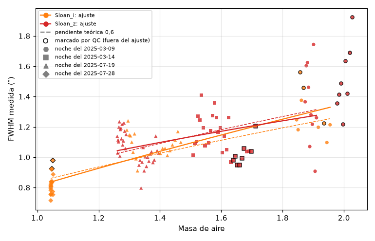
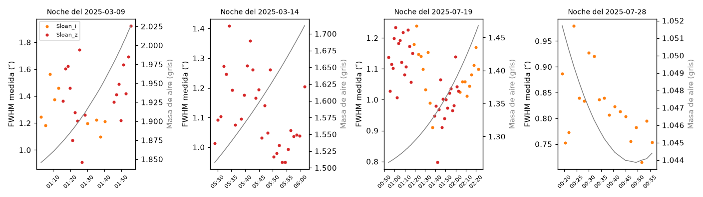

# gtc-image-quality

Herramienta de línea de comandos que mide la calidad de imagen de OSIRIS+ en el Gran Telescopio Canarias (GTC) con datos reales de su archivo público. Para cada fotograma mide la FWHM, la elipticidad, el fondo del cielo y la saturación. Marca los fotogramas dudosos con un motivo explicable y relaciona la calidad medida con la masa de aire, el filtro y las condiciones que registra la cabecera.

La especificación está en [docs/SPEC.md](docs/SPEC.md) y el registro de cada paso, con los errores y las decisiones, en [docs/bitacora.md](docs/bitacora.md).

## Resultados

Se midieron 132 fotogramas crudos de OSIRIS+ en Sloan i y z de cuatro noches de 2025, con masa de aire de 1,04 a 2,03. Se habla siempre de FWHM medida en la imagen, no de seeing: incluye la turbulencia, el telescopio, el enfoque y el guiado.

- **Medidas validadas.** Con estrellas sintéticas de FWHM y elipticidad conocidas, el error es como mucho del 1,7 % en FWHM y de 0,011 en elipticidad. Con datos reales coinciden con los productos reducidos del propio GTC (DRAGO): diferencias del −0,3 % y +0,1 % en FWHM en los dos fotogramas comparados.
- **Control de calidad.** 25 fotogramas marcados, cada uno con su motivo. Se revisaron todos a mano. Entre ellos hay un salto del telescopio durante la exposición (todas las estrellas dobles), estrellas hinchadas, una caída de transparencia con la traza de un satélite y fondos altos con la Luna llena a 18° del objeto y el Sol llegando al crepúsculo.
- **Masa de aire.** Entre noches, la FWHM crece con la masa de aire con pendientes de 0,74 (Sloan i, intervalo del 95 % de 0,60 a 0,88) y 0,49 (Sloan z, de 0,26 a 0,72), compatibles con el 0,6 de la teoría de la turbulencia. Dentro de una misma noche la turbulencia cambia más que lo que cambia la masa de aire, y la pendiente no se puede medir. Con solo cuatro noches no se puede separar la masa de aire de la turbulencia de cada noche.
- **Longitud de onda.** La teoría predice que la FWHM en z sea un 4,5 % menor que en i. Con 28 parejas de fotogramas tomados casi a la vez, el cociente z/i es 1,022 ± 0,018: no se ve ese efecto. Queda como pregunta abierta (bitácora, paso 5).
- **Condiciones.** La FWHM se correlaciona con la velocidad del viento en Sloan i (ρ = 0,76), pero lo arrastra una sola noche con poco viento y la mejor FWHM. Es un análisis exploratorio: con pocas noches no permite hablar de causas, pero muestra cómo se haría con el histórico del telescopio.





## Uso

Requiere Python 3.12 y [uv](https://docs.astral.sh/uv/).

```bash
uv sync
uv run gtc-iq fetch   --manifest data/manifest.csv --data data/raw      # unos 900 MB; comprueba los SHA-256
uv run gtc-iq measure --manifest data/manifest.csv --data data/raw --out results/frames.csv \
                      --stars results/stars.csv --jobs 8
uv run gtc-iq qc      --frames results/frames.csv --config config.yaml --out results/qc.csv
uv run gtc-iq report  --frames results/frames.csv --qc results/qc.csv --config config.yaml \
                      --manifest data/manifest.csv --data data/raw --out reports/
```

El informe queda en `reports/report.md`. Con el mismo manifiesto, el informe sale idéntico byte a byte. Para usar otros bloques del archivo, `gtc-iq manifest` construye el manifiesto a partir del CSV que exporta el formulario de búsqueda (sección 8 de la SPEC).

## Cómo lo construí

**Especificación antes que código.** Escribí primero la [especificación](docs/SPEC.md): el problema, qué medir y cómo validarlo, qué queda fuera y los riesgos. Antes de escribir una línea de medida leí cabeceras reales del archivo para no suponer claves. Cada desviación de la especificación se discute y queda registrada como decisión en su sección 12. Por ejemplo, medir sobre los crudos en lugar de sobre los productos reducidos, después de ver que estos solo se descargan en ZIP de 133 MB por fotograma.

**Pasos pequeños y revisados.** El trabajo se hizo en cinco pasos: especificación; descarga y lectura de cabeceras; medidas con imágenes sintéticas; datos reales y control de calidad; análisis e informe. Cada paso termina con tests en verde, se revisa antes de subirlo y se anota en la [bitácora](docs/bitacora.md), incluidos los errores.

**Validar contra algo conocido.** Las medidas se validaron en dos niveles. Con estrellas sintéticas de respuesta conocida, con un criterio de aceptación fijado de antemano. Con datos reales, contra los productos reducidos del propio observatorio. Con eso aparecieron errores que no se habrían visto mirando solo los números: el ajuste partía de la estrella vecina más brillante en el 42 % de los recortes, la elipticidad por momentos que pedía la especificación no cumplía el criterio, y el ruido del fondo no se debía al viñeteo, como supuse al principio, sino a estrellas débiles no resueltas del plano galáctico. Los errores de código se reprodujeron primero con un test y después se corrigieron.

**Reglas explicables.** El control de calidad son reglas configurables, no un modelo opaco. Cada marca cita el valor medido y el umbral, y las reglas comparan cada fotograma con el resto de su noche y su filtro. Los umbrales se ajustaron al ver los datos reales y la decisión quedó documentada. Por ejemplo, la regla de saturación marcaba un filtro entero por una propiedad del campo, no por un fallo de los fotogramas.

**Honestidad con los resultados.** Los resultados que no salen como dice la teoría (la pendiente dentro de cada noche, el cociente entre filtros) se muestran con su intervalo y se dejan como preguntas abiertas, sin forzar una explicación.

**Ingeniería.** Python 3.12 con uv, astropy y photutils, typer, pydantic y matplotlib. Tipado estricto con mypy, ruff y 86 tests sin red ni ficheros reales, todo en CI. Los FITS no se versionan: un manifiesto con la URL y el SHA-256 de cada producto permite reproducir exactamente los mismos datos.

## Limitaciones

- Sin flat: válido para FWHM y elipticidad, pero el nivel del fondo solo se compara dentro de una noche y filtro (SPEC 3).
- Cuatro noches no bastan para separar causas. Con el histórico del archivo se podría repetir el análisis a gran escala.
- Dos estrellas a menos de unas 1,5 FWHM se detectan como una sola. Lo mitiga usar la mediana de muchas estrellas.

## Datos

Datos públicos del Archivo Científico del GTC, en el Centro de Astrobiología (CAB, INTA-CSIC): https://gtc.sdc.cab.inta-csic.es/gtc/. Los programas y bloques usados están en `data/manifest.csv`.
